# Thiết Kế DDL & ERD Kênh AI / WhatsApp trên Postgres (Supabase)

**Trạng thái:** Dự thảo chuyển đổi hạ tầng (KV → Postgres/Supabase PG 17+) · 2026-10-09  
**Nguồn tham chiếu:** `erd-ai-extractor (1).md` (Hình A & B của Lead), `contracts/src/trip.zod.ts`, `supabase/migrations/*`.  
**File DDL đi kèm:** [`docs/specs/db/20261009000000_ai_channel.sql`](db/20261009000000_ai_channel.sql)  
**File kiểm thử tự động:** [`docs/specs/db/ai_channel.test.sql`](db/ai_channel.test.sql)

---

## 1. Hình C: Sơ Đồ Thực Thể Kênh AI (Kết Nối Hạ Tầng Team)

Kênh AI/WhatsApp sử dụng trực tiếp các bảng `scenario`, `revision`, `app_setting` của team làm bảng gốc. Báo giá do bot tạo là một `scenario` với `source = 'whatsapp'`; các bản trích xuất được lưu vào `revision` với `author = 'ai'`. Các bảng mới dưới đây quản lý vòng đời hội thoại, khóa phân tán (lease), hàng đợi chuyển máy (handoff), và vết trích xuất NLP.

```mermaid
erDiagram
    SCENARIO ||--o| AI_ENQUIRY : "scenario_id"
    REVISION ||--o| AI_EXTRACTION : "revision_id"
    WA_CONVERSATION ||--o{ WA_MESSAGE : "conversation_id"
    WA_CONVERSATION ||--o{ WA_HANDOFF : "conversation_id"
    WA_CONVERSATION ||--o{ AI_ENQUIRY : "conversation_id"
    APP_SETTING ||--o{ AI_SETTING_AUDIT : "theo doi key ai"
    AI_PROVIDER_KEY
    AI_PROVIDER_STAT
    WA_INBOUND_CLAIM

    SCENARIO {
        uuid id PK
        enum owner_role "guest|agent|instructor|staff"
        text owner_ref "wa:phone_hash"
        enum source "whatsapp"
        enum status "draft|submitted|expired|archived"
        jsonb working_trip "Trip bff dang sua"
        jsonb extras "transferDirection"
    }
    REVISION {
        uuid id PK
        uuid scenario_id FK
        int seq "1..n"
        jsonb trip "Trip da chot luot"
        enum author "ai"
    }
    AI_ENQUIRY {
        uuid scenario_id PK
        uuid conversation_id FK
        text phone "unique khi closed_at null"
        enum review_state "pending_review|approved|cancelled"
        timestamptz approved_at
        text approved_by_ref
        text_array staff_alerts
        jsonb staff_edits
        jsonb notes "diveNotes, specialRequests"
        text confirmed_reply
        timestamptz sent_to_guest_at
        timestamptz closed_at
    }
    AI_EXTRACTION {
        uuid revision_id PK
        jsonb field_states "given|inferred|default|missing"
        enum provider "gemini|deepseek"
        text model
        int tokens_in
        int tokens_out
        int latency_ms
    }
    WA_CONVERSATION {
        uuid id PK
        text phone "unique khi ended_at null"
        enum language "en|zh"
        text_array open_fields
        int stall_count
        jsonb stated_values
        timestamptz last_guest_at "cua so 24h Meta"
        timestamptz started_at
        timestamptz ended_at
        enum end_reason "reset|expired"
        uuid lock_token
        timestamptz lock_until
    }
    WA_MESSAGE {
        bigserial id PK
        uuid conversation_id FK
        enum role "guest|assistant|staff"
        text body "max 4096"
        text wa_message_id "wamid"
        enum reply_kind "converse|handoff|apology..."
        text staff_ref
        timestamptz created_at
    }
    WA_INBOUND_CLAIM {
        text wa_message_id PK
        enum state "in_flight|done"
        uuid fence_token
        timestamptz expires_at
    }
    WA_HANDOFF {
        uuid id PK
        uuid conversation_id FK
        text phone "unique khi resolved_at null"
        enum reason "guest_asked_for_human|complaint..."
        text_array missing_fields
        text context "max 200"
        timestamptz since
        timestamptz told_at
        timestamptz resolved_at
        text resolved_by_ref
        enum resolution "resume|reset|auto_resume|expired"
    }
    AI_PROVIDER_KEY {
        enum provider PK "gemini|deepseek"
        bytea key_enc "AES-256-GCM"
        text last4
        timestamptz updated_at
        text updated_by_ref
    }
    AI_SETTING_AUDIT {
        bigserial id PK
        timestamptz at
        text actor_ref
        jsonb diff
    }
    AI_PROVIDER_STAT {
        date day PK
        enum provider PK "gemini|deepseek"
        int ok
        int fail
        int fallback
        bigint ms_sum
        int n
    }
    APP_SETTING {
        text key PK "ai"
        jsonb value "version, primary, fallback, timeout"
        timestamptz updated_at
    }
```



---

## 2. Bảng Chuyển Đổi Chi Tiết: KV (Redis) → Postgres (Supabase)

### A. Đối chiếu các Key trong KV Store cũ

| Key KV Cũ | Kiểu KV Cũ | Bảng & Cột Postgres Mới | Giải Thích Kiến Trúc |
|---|---|---|---|
| `thread:{phone}` (metadata) | JSON (24h TTL) | `wa_conversation` (`open_fields`, `stall_count`, `stated_values`, `last_guest_at`) | Quản lý phiên hội thoại có trạng thái rõ ràng, có thời điểm bắt đầu/kết thúc thay vì chỉ dựa vào TTL Redis. |
| `thread:{phone}` (mảng turns) | JSON list | `wa_message` (`conversation_id`, `role`, `body`, `reply_kind`, `created_at`) | Chuẩn hóa 1-nhiều: mỗi tin nhắn là 1 dòng, truy vấn linh hoạt, đánh index thời gian, không giới hạn cứng 20 lượt. |
| `phonelock:{phone}` | String `SET NX EX 30` | `wa_conversation.lock_token` + `lock_until` | Cơ chế Lease phân tán ngay trên hàng hội thoại; giải phóng tức thì hoặc tự hết hạn sau 30s. |
| `claim:{wa_message_id}` | String (`in_flight` / `done`) + fence token | `wa_inbound_claim` (`wa_message_id`, `state`, `fence_token`, `expires_at`) | Chống xử lý trùng tin nhắn từ Meta webhook bằng câu lệnh `INSERT ... ON CONFLICT DO UPDATE` nguyên tử (atomic). |
| `pause:{phone}` | JSON | `wa_handoff` (`phone`, `reason`, `context`, `missing_fields`, `since`, `told_at`) | Lưu lịch sử chuyển máy nhân viên đầy đủ, theo dõi thời gian phản hồi (SLA) thay vì bị ghi đè. |
| `paused_phones` | Redis Set | Truy vấn: `SELECT * FROM wa_handoff WHERE resolved_at IS NULL` | Tận dụng Partial Index `wa_handoff_pending_idx`, không cần đồng bộ thủ công giữa 2 key Redis. |
| `settings:ai` | JSON | `app_setting` (dòng có `key = 'ai'`) | Hợp nhất vào bảng cấu hình dùng chung của hệ thống, hỗ trợ Optimistic Lock qua trường `version`. |
| `settings:ai.keys` | JSON (mã hóa) | `ai_provider_key` (`provider`, `key_enc`, `last4`) | Chuẩn hóa lưu khóa LLM dạng `bytea` mã hóa AES-256-GCM đồng nhất với `user_session.odoo_key_enc`. |
| `settings:ai:audit` | JSON list (cắt 50 dòng) | `ai_setting_audit` (`id`, `at`, `actor_ref`, `diff`) | Lưu toàn bộ lịch sử thay đổi cấu hình vào DB quan hệ, không bị cắt xén dữ liệu. |
| `stats:ai:{day}:{p}:{f}` | Redis Hash (14 ngày TTL) | `ai_provider_stat` (`day`, `provider`, `ok`, `fail`, `fallback`, `ms_sum`, `n`) | Lưu thống kê tổng hợp theo ngày vĩnh viễn, ghi nhận bằng Upsert cộng dồn số học. |

---

### B. Đối chiếu các trường trong `HonoQuotationDraft` (Báo Giá Cũ)

Trong repo cá nhân cũ (`technext-edge`), toàn bộ báo giá được nhồi vào một cấu trúc JSON duy nhất `HonoQuotationDraft`. Khi chuyển sang hệ thống team, cấu trúc này được bóc tách chính xác như sau:

| Trường trong `HonoQuotationDraft` | Đích Đến Mới trong Postgres | Ghi Chú Xử Lý |
|---|---|---|
| `quoteId` | `scenario.id` (hoặc prefix mã hiển thị) | Định danh duy nhất của báo giá trong hệ thống. |
| `bffTrip` | `scenario.working_trip` & `revision.trip` | Đúng schema `contracts/src/trip.zod.ts`. |
| `pricing` (giá Odoo) | `snapshot.model` | **Giá chính thức chỉ từ Odoo**, đóng băng trong bảng `snapshot` theo từng revision. |
| `status` (`pending_hono_review`, `approved`, `cancelled`) | `ai_enquiry.review_state` | Trạng thái phê duyệt nội bộ của đội ngũ trước khi gửi khách. |
| `confirmedBy`, `confirmedAt` | `ai_enquiry.approved_by_ref`, `approved_at` | Truy vết nhân viên phê duyệt báo giá. |
| `staffAlerts` | `ai_enquiry.staff_alerts` | Các cảnh báo hệ thống cho nhân viên (vd: khách yêu cầu giảm giá đối tác, lịch lặn tùy chỉnh). |
| `staffEdits` | `ai_enquiry.staff_edits` | Lịch sử can thiệp sửa đổi thủ công của nhân viên trên Studio. |
| `notes` (`diveNotes`, `specialRequests`, `dietNotes`) | `ai_enquiry.notes` | Ghi chú thô của khách chưa đồng bộ vào Odoo. |
| `aiConfirmedReply` | `ai_enquiry.confirmed_reply` | Bản thảo tin nhắn xác nhận do AI chuẩn bị sẵn cho nhân viên duyệt gửi. |
| `submission` | `submission` (bảng team đã có) | Lưu thông tin đặt chỗ chính thức sau khi khách chốt. |
| `slug`, `quotationUrl` | `share_token` (bảng team đã có) | Token URL bảo mật cho khách xem báo giá trực tuyến (`/quote/:token`). |
| `phone` | `ai_enquiry.phone` & `scenario.owner_ref` | Liên kết ngược về số điện thoại WhatsApp của khách. |
| ❌ `lineItems` & Tổng giá cục bộ | **LOẠI BỎ** | Hệ thống team chỉ dùng giá tính từ Odoo (`snapshot.model`), không duy trì công thức tính giá cục bộ để tránh lệch giá. |
| ❌ `estimator.cookie`, `mirrorUrl` | **LOẠI BỎ** | Không cần thiết khi BFF và Engine tính giá cùng nằm trong một hạ tầng thống nhất. |

---

## 3. Bản Đồ Truy Vấn Nóng & Chỉ Mục Tối Ưu (Query → Index)

Hệ thống được thiết kế 4 chỉ mục chuyên dụng phục vụ các truy vấn với tần suất cao (đã được xác thực qua `EXPLAIN` trên Postgres thật):

```
+---------------------------------------------------------------------------------------------------------+
| Truy Vấn Nóng                                    | Index Phục Vụ                    | Kiểu Index Scan   |
+---------------------------------------------------------------------------------------------------------+
| 1. Tìm báo giá đang mở theo số điện thoại:        | ai_enquiry_active_phone_uidx     | Index Scan        |
|    WHERE phone = $1 AND closed_at IS NULL        | (Partial Unique Index)           | (1 row lookup)    |
|                                                  |                                  |                   |
| 2. Hàng đợi chuyển máy nhân viên (Handoff):      | wa_handoff_pending_idx           | Index Scan        |
|    WHERE resolved_at IS NULL ORDER BY since DESC | (Partial B-Tree Index)           | (Trang /handoff)  |
|                                                  |                                  |                   |
| 3. Lọc báo giá theo trạng thái duyệt (Studio):    | ai_enquiry_review_state_idx      | Bitmap Index Scan |
|    WHERE review_state = $1 ORDER BY created_at   | (review_state, created_at DESC)  | (Tab review)      |
|                                                  |                                  |                   |
| 4. Lấy 20 lượt chat gần nhất của phiên:          | wa_message_conversation_created_idx| Bitmap Index Scan |
|    WHERE conversation_id = $1 ORDER BY cr DESC   | (conversation_id, created_at DESC)| (Turn loop)       |
+---------------------------------------------------------------------------------------------------------+
```

---

## 4. Cơ Chế Xử Lý Đồng Thời & Tính Toàn Vẹn (Concurrency Architecture)

So sánh trực tiếp cơ chế xử lý tranh chấp giữa hệ thống KV cũ và Postgres DDL mới:

| Tình Huống Tranh Chấp | Triển Khai Trong KV (Cũ) | Triển Khai Trong Postgres (Mới) | Ưu Thế Của Postgres |
|---|---|---|---|
| **Chống trùng tin nhắn (Message Deduplication)** | `SET claim:{id} ... NX` kết hợp fence token kiểm tra bằng mã Node.js. | Câu lệnh nguyên tử `INSERT ... ON CONFLICT DO UPDATE WHERE expires_at < now() RETURNING *`. | Nguyên tử 100% trong 1 round-trip DB; loại bỏ hoàn toàn race condition khi 2 webhook Meta tới cùng mili-giây. |
| **Khóa luồng theo số điện thoại (Phone Concurrency)** | Redis `SET NX EX 30`; nếu Redis lỗi thì "fail-open" (bỏ khóa chạy tiếp). | **Lease trên hàng `wa_conversation`** (`lock_token`, `lock_until`). | Không dùng PostgreSQL Advisory Lock (tránh giữ transaction mở suốt 20s qua PgBouncer). Tự thu hồi sau 30s nếu worker crash. |
| **Một phiên / Một báo giá mở trên mỗi số** | Quét toàn bộ danh sách báo giá (`findOpenQuotationForPhone`) với O(N). | **Partial Unique Index**: `UNIQUE (phone) WHERE closed_at IS NULL`. | DB cưỡng chế tính toàn vẹn ở tầng nhân; tìm kiếm tức thì O(1) qua chỉ mục B-tree. |
| **Cập nhật cài đặt AI (Settings Concurrency)** | Ghi đè trực tiếp (Last-write-wins). | **Optimistic Concurrency Control**: `UPDATE app_setting ... WHERE key = 'ai' AND value->>'version' = $old_ver`. | Ngăn chặn việc hai quản trị viên cùng sửa cấu hình làm mất thay đổi của nhau. |

---

## 5. Chính Sách Lưu Trữ, Dọn Dẹp (TTL) & Dữ Liệu Nhạy Cảm (PII)

### A. Quy định dọn dẹp định kỳ (Retention & Purge)
Hệ thống tận dụng tiến trình cron job đêm (03:00 UTC) sẵn có của team:
1. **Lịch sử tin nhắn (`wa_message` & `wa_handoff.context`):**
   - Xóa các tin nhắn có `created_at < now() - (raw_text_ttl_days || ' days')::interval`.
   - Tham chiếu giá trị `raw_text_ttl_days = 30` đã được định nghĩa trong `app_setting`.
2. **Claim tin nhắn đã xử lý (`wa_inbound_claim`):**
   - Xóa các bản ghi đã `state = 'done'` hoặc `expires_at < now() - interval '24 hours'`.
3. **Thống kê AI (`ai_provider_stat`):**
   - Tự động xóa dữ liệu thống kê chi tiết cũ hơn 90 ngày.

### B. Danh mục dữ liệu nhạy cảm (PII & Health Data)
Cần áp dụng chính sách bảo vệ dữ liệu theo tiêu chuẩn dự án:
- `wa_conversation.phone` / `ai_enquiry.phone`: Số điện thoại khách hàng (PII) — không xuất ra log công khai.
- `wa_message.body` / `wa_handoff.context`: Nội dung tin nhắn của khách — tuân thủ thời hạn lưu 30 ngày.
- `ai_enquiry.notes`: Chứa thông tin dị ứng, yêu cầu bữa ăn (`allergies`, `dietNotes`) — đây là **dữ liệu sức khỏe (Health Data)**, tuyệt đối không lặp lại trong server logs hay truyền ra ngoài phạm vi bếp/lễ tân.

---

## 6. Kế Hoạch Chuyển Đổi Dữ Liệu (Data Migration & Cutover Plan)

### A. Phạm vi dữ liệu chuyển đổi
- **Chuyển đổi:**
  1. Các báo giá đang ở trạng thái `pending_hono_review` hoặc `approved` còn hạn (Active Quotations).
  2. Các yêu cầu chuyển giao nhân viên đang chờ xử lý (`paused_phones`).
- **Không chuyển đổi (Stateless Cutover):**
  - Lịch sử chat đang dở (TTL 24h trên KV): Để tự nhiên kết thúc phiên; khách nhắn lại sau thời điểm cutover sẽ mở phiên mới trên Postgres.
  - Các khóa tạm (`phonelock`), claim tạm (`claim:*`), bộ đếm thống kê tạm: Bỏ qua hoàn toàn.

### B. Quy trình thực hiện (Cutover Runbook)
1. Chạy migration `20261009000000_ai_channel.sql` lên cơ sở dữ liệu Supabase đích.
2. Chạy script chuyển đổi 1 lần `migrate-kv-to-pg.mjs` với cờ `--dry-run` để đối chiếu số lượng bản ghi báo giá.
3. Chạy lệnh migrate thật: Đọc các draft từ KV, ghi vào `scenario` + `ai_enquiry` + `revision`.
4. Triển khai code BFF mới (đã chuyển sang dùng Postgres store).
5. Kiểm tra hàng đợi `/handoff` và danh sách `/quotes` trên môi trường mới.

---

## 7. Các Câu Hỏi Mở & Khuyến Nghị Trình Lead

1. **Quy ước `owner_role` và `owner_ref` cho `scenario` do bot tạo:**
   - *Hiện trạng:* Team quy định `owner_role in ('guest','agent','instructor','staff')`.
   - *Đề xuất:* Với khách đến từ WhatsApp, lưu `owner_role = 'guest'` và `owner_ref = 'wa:' || encode(sha256(phone::bytea), 'hex')` (hoặc lưu số điện thoại chuẩn hóa `'wa:' || phone`). Khuyến nghị dùng hash để đồng nhất với triết lý bảo vệ PII của team.
2. **Vị trí của trường `review_state` (Trạng thái duyệt báo giá):**
   - *Phương án A (Hiện tại):* Lưu `review_state` trong bảng `ai_enquiry` để không làm thay đổi bảng `scenario` của team.
   - *Phương án B:* Bổ sung giá trị vào `scenario.status` (hiện chỉ có `draft`, `submitted`, `expired`, `archived`) thành `pending_review`. Lead ưu tiên phương án giữ nguyên bảng team hay mở rộng enum check của `scenario`?
3. **Mã hóa số điện thoại trong cơ sở dữ liệu:**
   - Số điện thoại hiện lưu dạng `text` chuẩn hóa (`check (phone ~ '^[0-9]{6,15}$')`). Lead có yêu cầu mã hóa cột `phone` bằng AES-GCM (tương tự `odoo_key_enc`) hay chỉ cần kiểm soát truy cập qua RLS và phân quyền service-role?
