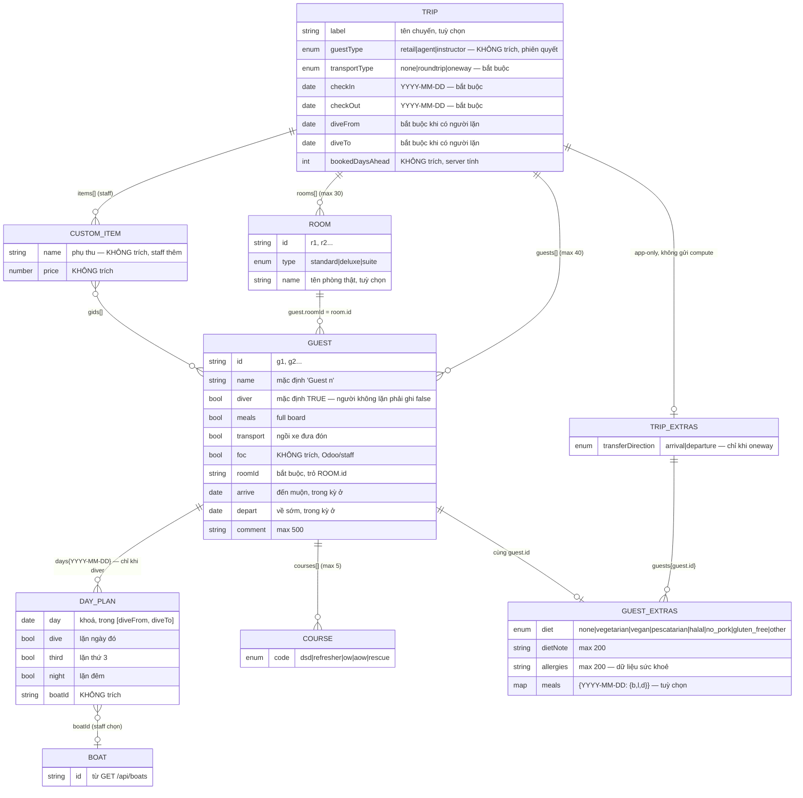
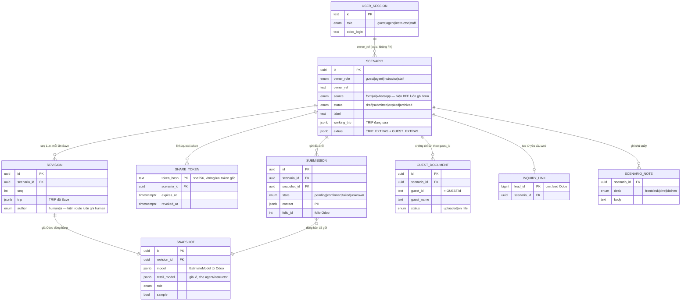

# ERD cho AI Extractor — Trip và nơi nó được lưu

Trạng thái: 2026-10-08 · nguồn: `contracts/src/trip.zod.ts`, `bff/src/trip/meals.ts` (extras), `supabase/migrations/*`.
Đọc cùng `docs/integration/schema.md` (luật hợp lệ, endpoint, `EstimateModel`).

Extractor đọc tin nhắn (WhatsApp, email, chat) và trả **một `Trip` + `extras`**. Nó không đọc DB, không gọi
Odoo, không tính giá, không đặt chỗ. Hình A là thứ extractor phải điền. Hình B chỉ để hiểu Trip đi đâu sau đó.

## A. Thứ extractor điền — `Trip` và các phần con

**Đọc hình:**
- `TRIP_EXTRAS` / `GUEST_EXTRAS` là dữ liệu chỉ của app (`scenario.extras`), không đi vào `compute`. Chúng chỉ tới Odoo
  lúc đặt chỗ: `transferDirection` thành `Trip.transferDirection`, `diet` + `dietNote` và `allergies` thành
  `Guest.diet` / `Guest.allergies`.
- Odoo không có trường cho bữa sáng/trưa/tối (`GUEST_EXTRAS.meals`). Bếp đếm suất theo ngày. Extractor chỉ cần
  `GUEST.meals` (full board hay không).

### Extractor trích gì, bỏ gì

| Nhóm | Trường | Ghi chú |
|---|---|---|
| **Trích** | `checkIn`, `checkOut`, `diveFrom`, `diveTo` | Ngày tuyệt đối `YYYY-MM-DD`. "Tháng 11", "cuối tuần sau" → để trống + hỏi lại, không đoán |
| **Trích** | số khách, tên, ai lặn (`diver`), khoá học (`courses`) | Không rõ ai lặn → hỏi. Mặc định `diver: true` là cái bẫy |
| **Trích** | số phòng, loại phòng (`ROOM.type`), ai ở phòng nào (`roomId`) | Không nói gì → một phòng `r1` standard cho cả nhóm (như form) |
| **Trích** | `transportType`, `TRIP_EXTRAS.transferDirection` | "Đón ở sân bay" một chiều → `oneway` + `arrival` |
| **Trích** | `meals`, `GUEST_EXTRAS.diet/dietNote/allergies`, `arrive/depart`, `comment` | Dị ứng là dữ liệu sức khoẻ: không lặp lại trong log |
| **Không trích** | `guestType`, `bookedDaysAhead`, `foc`, `boatId`, `items`, `vanMeta`, `dmByDay`, giá | Phiên, server, Odoo hoặc staff quyết. Bot không bao giờ tự nói giá |
| **Không trích** | tên/email/điện thoại người đặt (`contact`) | Chỉ hỏi ở bước đặt chỗ, do người bấm tay |

Mỗi trường trả kèm một trạng thái: `given` (khách nói rõ) · `inferred` (suy ra) · `default` · `missing`.
Trường bắt buộc mà `missing` thì bot hỏi lại trước khi gọi BFF.

## B. Trip đi đâu sau khi extractor trả về

**Đọc hình:**
- Extractor gọi `POST /api/estimates` với `{trip, extras?}`. Ở bước tạo, `extras` **chỉ nhận `transferDirection`**
  (khoá khác → 422). Ăn kiêng / dị ứng / bữa ăn gửi sau bằng `PATCH /api/estimates/:id/extras`.
- BFF tạo `SCENARIO`, gọi Odoo `compute`, trả `model` + link.
- **Chưa dựng:** cột `source` (`ai` / `whatsapp`) và `revision.author = 'ai'` đã có trong DB, nhưng route hiện luôn ghi
  `form` / `human`. Kênh AI cần BFF nhận biết người gọi là bot rồi ghi đúng (`schema.md` mục 8).
- `GUEST.id` là khoá nối Trip với `GUEST_DOCUMENT` và `scenario.extras.guests`. Extractor đặt `g1..gn` và giữ ổn định
  giữa các lần sửa; đổi id là mất chứng chỉ và ghi chú ăn uống của khách đó.
- Bảng `app_setting` và `rate_hit` (cấu hình, chống spam) không liên quan tới extractor nên không vẽ.
